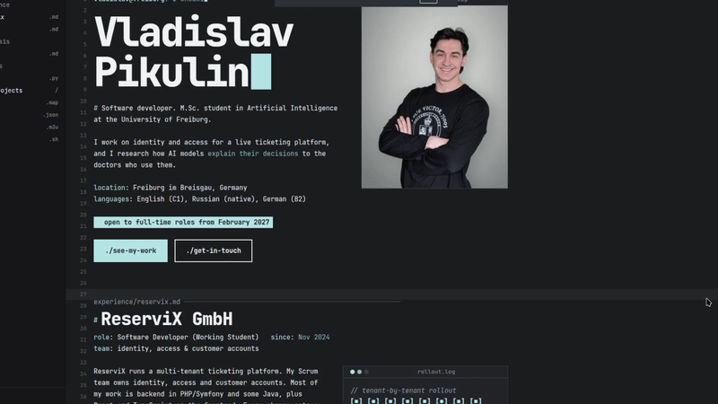

## Hello there, I'm Влад (Vlad)  

  <samp>
Software developer and M.Sc. student in Artificial Intelligence at the <b>University of Freiburg</b>. 
From  <b>Vladivostok, Russia</b>, now living in  <b>Freiburg im Breisgau, Germany</b>.
  </samp>

  
  

 

### What I'm working on

- 🧠 **ORION** (M.Sc. thesis): explainable AI for kidney transplant aftercare. Making a clinical model explain its predictions, plus an agent that checks them against clinical guidelines (RAG).
- 💊 **SEER**: offline reinforcement learning on cancer registry data.
- 🥊 **[UFC Prediction](https://github.com/vpik009/UFC-Prediction)**: fight predictor with a custom Elo rating, 64.8% accuracy on the last 50 events.
- 🎨 **[Image Colourizer](https://github.com/vpik009/Image-Colourizer)**: encoder-decoder CNN that colours black-and-white photos.

 

### Portfolio Site

  

 

### Tools

  
  
  
  
  
  
  
  
  
  
  
  
  
  
  
  

 

### Contact me

  
  
  

 

  

